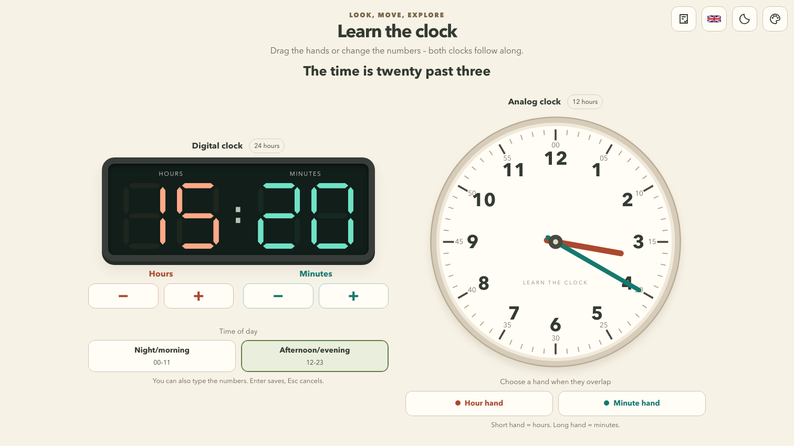
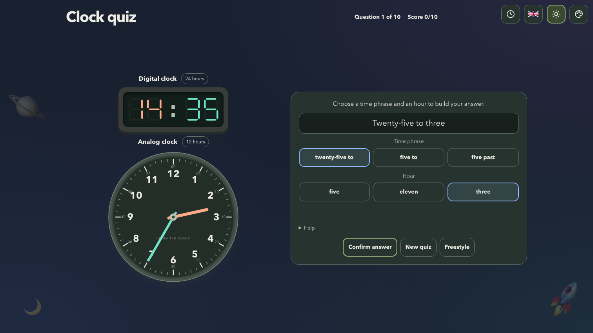

# Learn the Clock

Learn analog and digital clocks through freestyle play and quizzes. Norwegian
and English, four difficulty levels, light/dark mode, and three backgrounds.

Fits laptop and large portrait phone viewports without scrolling. On phones,
secondary options are under **More controls**. Very small screens retain
vertical scrolling. No accounts.

Language, light/dark mode, background, quiz difficulty, and clock display mode
are remembered in your browser's localStorage. Clock time, unfinished edits,
and quiz progress are not saved across reloads. The default is Norwegian for
browsers whose preferred language is Norwegian (`nb`, `nn`, or `no`), and English
otherwise. A Norway region alone (for example, `en-NO`) does not select Norwegian.
A saved language choice takes precedence. Clear this site's browser data
to restore the defaults. If storage is unavailable, preferences still work for
the current session and a warning is logged in the browser console.

[GitHub Pages](https://v3gard.github.io/learn-the-clock/)

Donations are appreciated and help fund future educational games:
[buymeacoffee.com/v3gard](https://buymeacoffee.com/v3gard).

## Screenshots





## Run locally

Requires [Bun](https://bun.sh/).

```sh
bun install
bun run dev
```

Production build: `bun run build`. Preview with `bun run preview` at
`http://localhost:4173/learn-the-clock/`.

Checks: `bun run lint` and `bun test`.

## Code layout

`App.tsx` owns navigation, language, theme, and page tools. Both screens stay
mounted when navigating so their progress and unfinished edits are preserved.

| Area | Files in `src/` |
| --- | --- |
| Freestyle clock screen and input behavior | `FreestyleClock.tsx` |
| Pointer capture and analog dragging | `useClockDrag.ts` |
| Shared clock rendering | `Clocks.tsx` |
| Time formatting, editing reducer, and clock geometry | `clock.ts` |
| Quiz flow and answer submission | `Quiz.tsx` |
| Answer rendering and restart dialog focus handling | `QuizAnswers.tsx`, `QuizRestartDialog.tsx` |
| Celebration animation and cleanup | `useConfetti.ts` |
| Question generation and quiz reducer | `quizModel.ts` |
| Localized interface text | `i18n.ts`, `quizText.ts` |
| Background selection and donation information | `Personalization.tsx`, `Support.tsx` |
| Shared popover title and close button | `ToolbarPanelHeading.tsx` |
| Validated localStorage preferences and persistence hook | `preferences.ts` |

Screen-specific buttons, flags, and clock details are private components in their
owning modules. Components are exported only when another module uses them.

Domain tests live in `tests/clock.test.ts` and `tests/quiz.test.ts`.

## Deployment

Select **Settings → Pages → Source → GitHub Actions** in the GitHub repository.
Pushing to `main` builds and deploys automatically.
